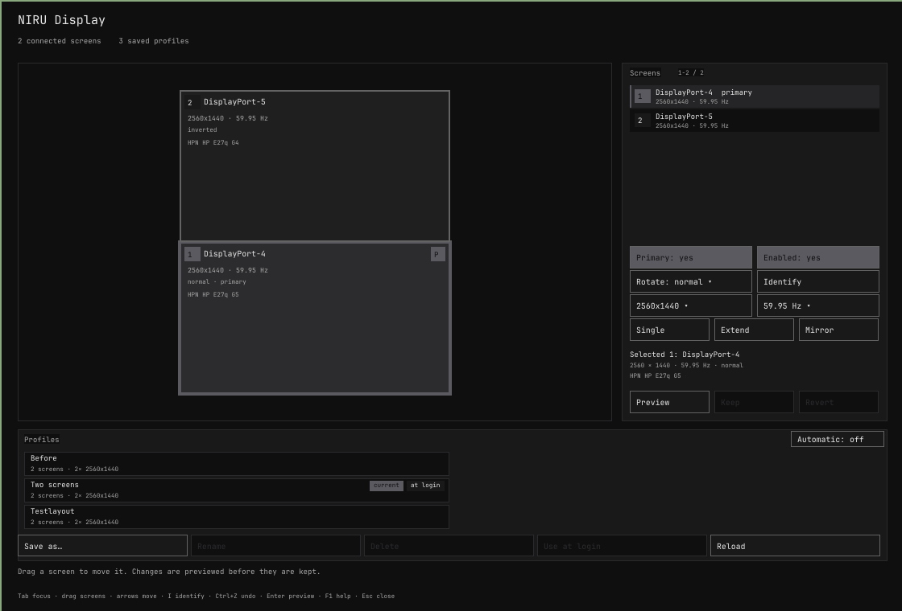

# NIRU Display

Graphical monitor layout editor with safe previews and profiles for the NIRUX X11 desktop.

**Status: beta** · Part of the [NIRUX](https://github.com/nirucon/nirux) suite · [MIT License](LICENSE)



## About

NIRU Display (`nirudisplay`) is a lightweight graphical monitor editor. It edits
a draft, shows the screens as they are arranged, and sends every change through
the same `niructl display` transaction as the CLI and NIRU Launcher. It owns no
profile store, no xrandr parser and no rollback daemon: NIRUWM's `niructl` does
the work, so the window can never disagree with the session.

The monitor arrangement is deliberately separate from NIRUWM's tiling layouts;
the bar's `layout` module still controls tile/monocle/floating, not which
monitor is where.

In scope: resolution, refresh rate, position, rotation and primary; mirror,
extend and single; profiles matched by screen identity; automatic switching on
hotplug and lid. Not offered: arbitrary modelines, fractional per-screen scaling
(X11 has no sound way to do it), ICC calibration, DDC/CI, HDR and VRR, automatic
rotation from a tilt sensor, and Wayland. The window does not advertise controls
the current X session cannot provide.

## Features

- Drag screens to move them, with a frozen canvas, a dead zone and edge
  snapping; arrow keys move by 1 px (10 px with `Shift`).
- Stable screen numbers shared by the canvas, the list and Identify; connector,
  EDID manufacturer/model and a serial suffix tell identical monitors apart.
- Enable or disable outputs, primary screen, resolution, refresh rate and
  rotation, plus Single, Extend and Mirror layout actions. Invalid layouts are
  drawn in the warning colour and block Preview.
- Identify every active screen with its number, connector and model.
- **Safe preview:** a layout is applied for 15 seconds with a large countdown;
  Keep confirms it, Revert or the timeout restores the previous layout. The
  timeout runs in a separate `niructl` process, so a crash of the window cannot
  leave a risky layout in place.
- Profiles: save, load, rename, update and delete, with summaries, **current**,
  **at login**, **auto** and **manual** badges, and a reason when a profile
  does not fit the connected screens.
- Opt-in startup profile, applied once by `niruwm-session` at login.
- **Automatic switching** on hotplug and lid close (off by default): a profile
  that fits exactly, else the layout these screens had last time, else the
  current layout with new screens to the right. Profiles follow their screens
  by identity (make, model and serial).
- Zoom with the wheel, pan with the middle button, `0` to fit.
- Works down to 560×420 with a compact layout below 900×700.
- Event-driven: RandR and inotify events, no polling; an idle window starts no
  process.

The full description of the editor, preview and profile behaviour and the event
model is in [docs/EDITOR.md](docs/EDITOR.md).

## Requirements

- X11 with RandR and a NIRUX session: `niructl` from NIRUWM (automatic switching
  needs NIRUWM 0.17 or newer).
- Debian, Arch and Void glibc, x86_64. No GTK, Qt, Electron or WebView runtime.

## Installation

### With NIRUX

NIRU Display is a core component: `nirux install` and `nirux update` install and
update it from the pinned manifest, with its desktop entry and icon. Open it
from NIRU Launcher or run `nirudisplay`.

### Standalone

For development, after `cargo build --release`:

```sh
./install.sh    # installs to ~/.local (NIRUDISPLAY_PREFIX or NIRUX_PREFIX override)
```

It installs `bin/nirudisplay`, the desktop entry and the icon. It still needs
NIRUWM's `niructl` at run time.

## Usage

```sh
nirudisplay              # open the window
nirudisplay status       # connected screens and saved profiles
nirudisplay list         # saved profiles
nirudisplay --version
nirudisplay --help
```

| Key | Action |
|---|---|
| `Tab` | Move focus |
| Arrows (`Shift` for 10 px) | Move the selected screen when no property control is focused |
| `Space` / `Enter` | Activate the focused control |
| `Enter` on mode, rate or rotation | Open its list (arrows move, `Enter` chooses, `Esc` closes); left/right step through values |
| `I` | Identify screens |
| `R` | Reload the actual state (an edited draft stays one `Ctrl+Z` away) |
| `Ctrl+Z` | Undo a draft change |
| `Ctrl+S` | Save as… |
| `0` | Fit the canvas |
| `F1` | Help |
| `Esc` / `Q` | Close |
| During a preview: `Enter` / `Esc` | Keep / Revert |

Closing the window during a preview asks **Keep layout**, **Revert** or Cancel;
closing never reverts silently. Closing with unsaved changes asks first.

## Configuration

Profiles, the startup profile and the automatic-switching state are owned by
`niructl` and stored in NIRUWM's files (below). The rules for profiles and
automatic switching are in NIRUWM's
[docs/display-profiles.md](https://github.com/nirucon/niruwm/blob/main/docs/display-profiles.md).
The *Automatic* switch in the profile header turns automatic switching on or
off; a profile with `auto = false` is kept out of it.

`NIRUDISPLAY_NIRUCTL=/path/to/niructl` is a development override: when set, no
other `niructl` is used.

## Files and paths

| Path | Purpose |
|---|---|
| `~/.config/niruwm/displays.toml` | Profiles and the optional startup profile, owned by `niructl` |
| `~/.local/state/niruwm/display-preview.toml` | Pending preview transaction, owned by `niructl` |
| `~/.local/state/niruwm/display-memory.toml`, `display-auto.toml` | What automatic switching remembers and did last, owned by `niructl` |

## Troubleshooting

- **A layout went wrong:** do nothing; the preview reverts after 15 seconds,
  even if the window crashed.
- **A profile is dimmed:** it needs a screen that is not connected; its row
  says which one (for example *needs the built-in screen (the lid is
  closed)*).
- **Several profiles fit:** the header names them and asks you to pick one; the
  one you pick is used next time.
- **A saved login profile did not apply:** `niruwm-session` logs the missing
  output and leaves the connected screens on the previous layout.

## Uninstall

NIRU Display is removed with the suite by `nirux uninstall`. A standalone copy:
delete `~/.local/bin/nirudisplay`,
`~/.local/share/applications/nirudisplay.desktop` and
`~/.local/share/icons/hicolor/256x256/apps/nirudisplay.png`. Profiles belong to
NIRUWM and stay.

## Building from source

```sh
cargo build --release --locked
cargo test --locked
sh tests/cli-smoke.sh target/release/nirudisplay
cargo test --locked --test xvfb -- --ignored   # needs Xvfb, xdotool, xwd, xrandr, setxkbmap
```

The Xvfb test drives the window against a fixture `niructl` that records its
arguments and input; it never touches a real display or profile. CI also builds
and tests with Rust 1.85, the declared `rust-version`. Dependencies are already
used across the suite: `x11rb`, `ab_glyph` and `serde_json`.

## Status, disclaimer and how it's made

**Status: beta.** I use it on every machine with more than one screen; automatic
switching is the newest part and is off by default.

NIRUX and every niru* project are made by me, Nicklas Rudolfsson
([@nirucon](https://github.com/nirucon)), for me. They are tailored to my own
needs, preferences and workflows, on my own machines. If they fit yours too,
that's a nice bonus.

- **Free and open source.** Anyone is free to use, study, change and share
  it under the [MIT License](LICENSE).
- **No guarantees.** There is no warranty of any kind. Use it at your own
  risk, read what you install and keep backups of anything that matters.
- **How it's made.** Some of these projects I built from scratch by hand. In
  more recent releases I have used Claude, Anthropic's AI, to do much of the
  heavy lifting under my direction: I decide what to build and how it should
  behave, and I test it on my own machines. It saves me a lot of time, and
  the result is quite OK.
- **Alpha, beta, dev, and maybe forever.** Most things here are alpha, beta
  or dev, and may stay that way. Maybe one day there will be a real stable
  release, but given how fast development moves, and how I am as a person,
  maybe never :)

| Label | Meaning |
|---|---|
| dev | Under active construction; may not build, install or work yet. |
| alpha | Works on my machines, but incomplete or rough; expect breaking changes. |
| beta | In daily use on my machines and mostly complete; rough edges remain. |

## License

MIT License, see [LICENSE](LICENSE). Copyright (c) 2026 Nicklas Rudolfsson.
